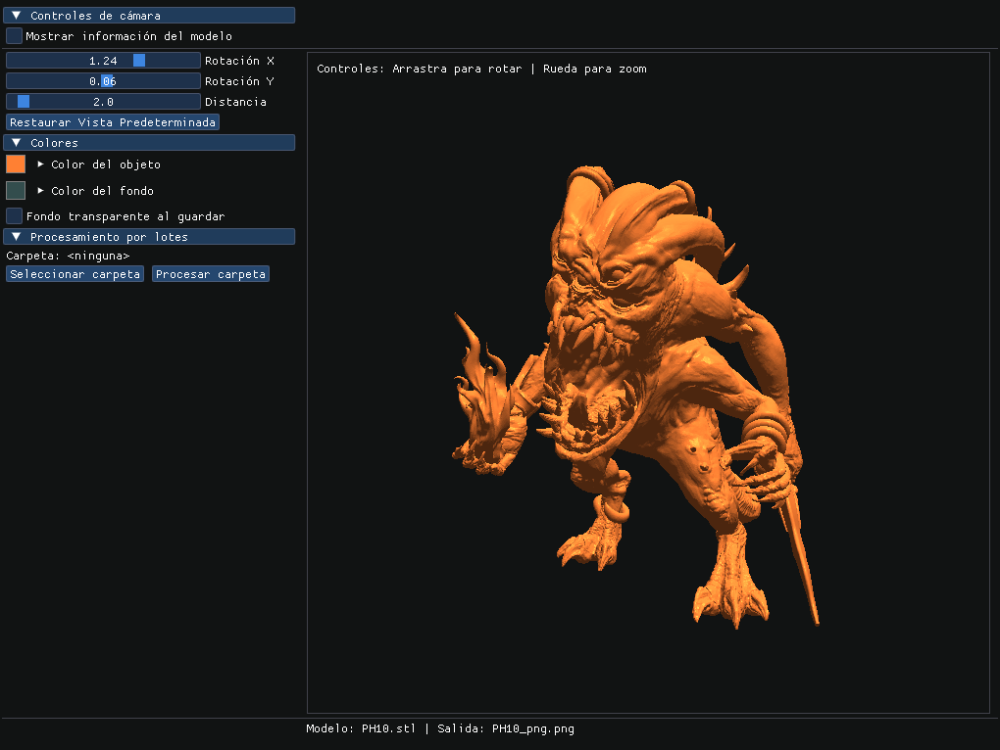

# Why STL Renderer?

One thing I've been using A LOT is stltopng from `Papa's Best` but the project didn't see any update past 2021 and to be honest... it was SUPER NECESARY to make an update haaha, so I've made a new app:

`GUI to set the camera angle and zoom`
`Directory rendering (Render all STL files from a specific directory)`
`Single and Multi Drag-n-drop behaviour in the same exe`

The idea is that you can drag-n-drop a single stl or multiple stl and it'll create the corresponding PNG renders at ULTRA FRECKING MEGA FAST SPEED with all your settings.... with `transparent background too :D`

# STL Renderer

STL Renderer is a high-performance application for converting STL files to PNG images. It is designed to be extremely fast and allow both individual and batch processing.



## Features

- 🚀 Ultra-fast rendering of STL files to PNG
- 🎨 Support for transparent backgrounds
- 🖌️ Customizable color settings for model and background
- 📷 Precise camera control (rotation, distance, zoom)
- 📁 Batch processing of entire folders
- 🖱️ Drag and drop functionality (single or multiple files)
- 💻 Intuitive graphical interface
- 🔧 Configuration saved between sessions

## Usage

### Drag and Drop

Simply drag one or more STL files onto the `STLRenderer.exe` executable. This will automatically generate PNG images with the same name (adding `_png.png`) in the same folder as the original files.

### Graphical Interface

To open the graphical interface, double-click on the `STLRenderer.exe` executable. From here you can:

1. Open STL files from the **File > Open** menu
2. Adjust model and background colors in the **Colors** panel
3. Configure camera rotation and distance with the **Camera** controls
4. Interactively rotate the model with the mouse in the preview window
5. Process entire folders with STL files from **File > Process folder**
6. Save the current image from **File > Save image**

## Command Line

STL Renderer can also be used from the command line to automate tasks. Without inputs it opens the GUI.

```bash
STLRenderer [options] [files.stl | directories]
```

| Option | Description |
| --- | --- |
| `-h, --help` | Show help |
| `-v, --version` | Show version |
| `-s, --silent` | Render without GUI (requires at least one input) |
| `-c, --color R G B` | Model color, components between 0.0 and 1.0 |
| `-bg, --background R G B` | Background color, components between 0.0 and 1.0 |
| `-a, --angle DEGREES` | Camera yaw in degrees |
| `-o, --output FILE.png` | Output path (only with a single STL input) |
| `--width N`, `--height N` | Image size in pixels (1–8192, default 1024×1024) |
| `--transparent`, `--opaque` | PNG background mode |
| `--` | Treat every following argument as an input |

Each `model.stl` is rendered to `model_png.png` next to it. Directories are processed non-recursively, and `.stl`
is matched case-insensitively. Exit codes: `0` success, `1` at least one file failed, `2` invalid arguments.

```bash
STLRenderer --width 1920 --height 1080 -c 0.9 0.4 0.1 --transparent parts/
STLRenderer -o preview.png -a 45 bracket.stl
```

Command-line options only apply to that run. GUI settings are stored in `%APPDATA%\STLRenderer\config.ini`;
for a portable setup, place a `config.ini` next to `STLRenderer.exe` and it will be used instead.

## System Requirements

- Windows 10 or higher
- Graphics card compatible with OpenGL 3.3+

## Building from Source

### Requirements

- Visual Studio 2022 (MSVC, C++17) or another Windows C++17 toolchain
- CMake 3.24 or higher
- Git and network access on first configure: GLFW, Dear ImGui, GLM and stb are fetched at pinned versions

### Steps

```bash
git clone https://github.com/SynrgStudio/STL-Renderer.git
cd STL-Renderer
cmake -S . -B build -G Ninja -DCMAKE_BUILD_TYPE=Release   # or omit -G for the Visual Studio generator
cmake --build build --config Release
ctest --test-dir build -C Release --output-on-failure
```

The executable is written to `build/` (or `build/Release/` with the Visual Studio generator).

The STL parser and CLI parsing are a platform-independent core library with their own tests, which can be
built anywhere with `-DSTL_RENDERER_BUILD_APP=OFF`.

## Contributing

Contributions are welcome. Please check [CONTRIBUTING.md](CONTRIBUTING.md) for more details on the contribution process.

## Documentation

To better understand the code structure and how it works internally, see [DOCUMENTATION.md](DOCUMENTATION.md).

## Roadmap

Some features we plan to add in the future:

- Support for other 3D formats (OBJ, FBX, etc.)
- Additional lighting modes
- Customizable shaders
- Export to additional formats (JPG, SVG, etc.)
- Support for Linux and macOS

## License

This project is licensed under the [GNU GPL v3 License](LICENSE) - see the LICENSE file for details. This ensures that any derivative work also remains as free and open-source software.

## Contact

If you have any questions or suggestions, feel free to open an issue in this repository.

---

Developed with ❤️ by Damian from SynrgStudio and Claude ❤️ (Yeah, I'm not a good dev, and Claude helped me a lot on this one, get over it XD)